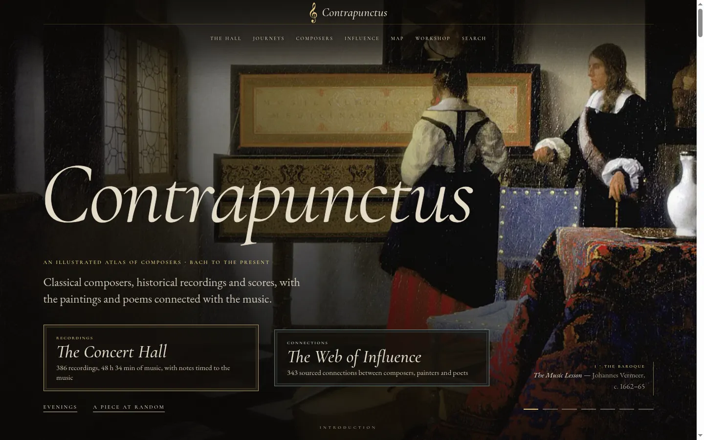
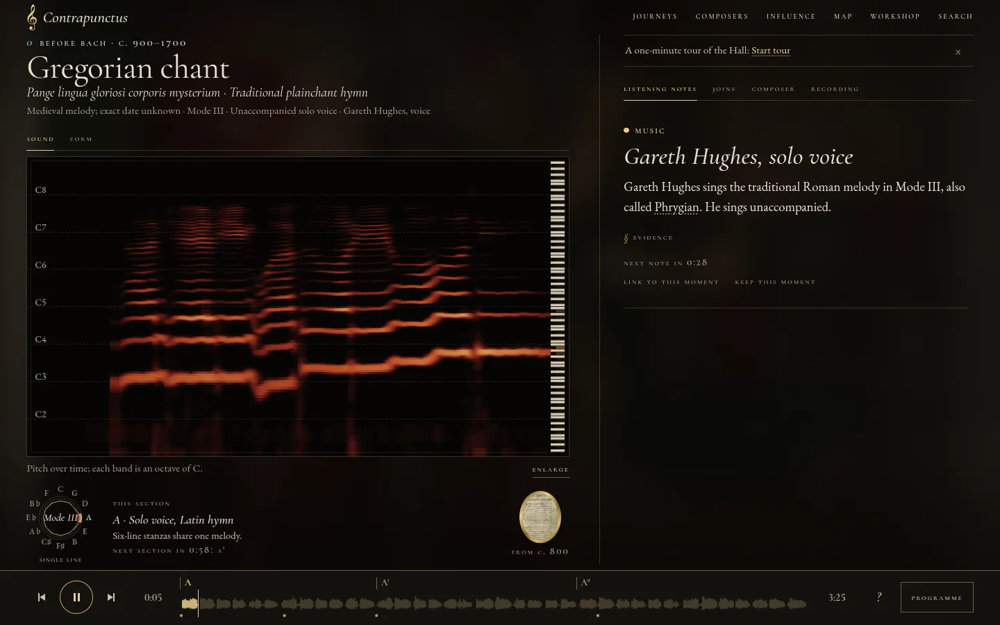
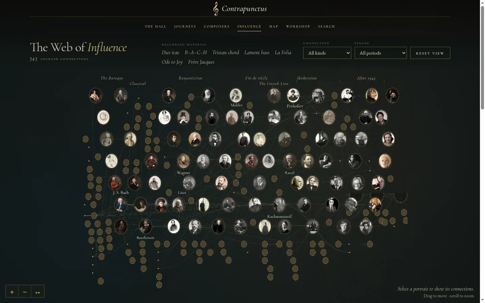
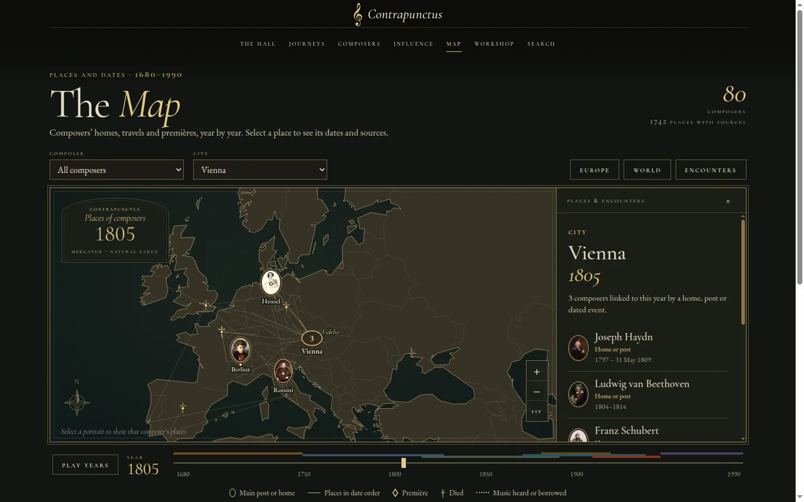

# Contrapunctus

An illustrated atlas of 80 classical composers, with historical recordings, scores, paintings and maps. I built it as a static site; it's live at [mottopanikeiku.github.io/contrapunctus](https://mottopanikeiku.github.io/contrapunctus/).

[](https://mottopanikeiku.github.io/contrapunctus/)

<p>



</p>

## What's in it

- [Concert Hall](https://mottopanikeiku.github.io/contrapunctus/hall.html): 386 recordings with timed listening notes, some aligned to engraved scores.
- [Web of Influence](https://mottopanikeiku.github.io/contrapunctus/influence.html): 343 sourced links between composers, teachers, performers, painters and poets.
- [Map](https://mottopanikeiku.github.io/contrapunctus/atlas-map.html): where composers lived and worked, from 1680 to 1990.
- [Composers](https://mottopanikeiku.github.io/contrapunctus/composers/index.html): biographies with playable notation examples and related art.
- [Journeys](https://mottopanikeiku.github.io/contrapunctus/journeys/index.html) and [performer comparisons](https://mottopanikeiku.github.io/contrapunctus/compare/index.html).
- A workshop, glossary, timeline and gallery. Press `/` to search.

## Run it

Node 22.12 or newer. The finished site is checked in under `docs/`, and GitHub Pages serves that folder straight from `main`.

```sh
npm ci
npm run serve
```

`npm run build` regenerates `docs/` from `content/` and `src/` (it takes a while, mostly image work), and `npm run validate` checks the content. Edit the sources, not the generated HTML.

## Adding a composer

1. Add `content/composers/<slug>.mjs`. Copy `satie.mjs`: name, dates, `era`, `epithet`, `facts`, `life` (HTML, `[[slug|Name]]` links to other composers), `sound`, and a `portrait` that names a Commons file.
2. Add recordings as `content/listen/<id>.mjs` (see `debussy-faune.mjs`). `node tools/audio.mjs search "<composer> <work>"` finds Commons audio, and `check` shows its licence.
3. List each recording id in `content/published.json`. Anything not listed is built but kept off the site.
4. Run `npm run validate`, then `npm run build`.

Quotations stay in the speaker's words and need a source. `npm run validate` parses every score, checks each recording's licence on Commons or the Internet Archive, and rejects influence links without a source. CI runs it on every push.

## Credits

- Recordings come from Wikimedia Commons and the Internet Archive under the public-domain or Creative Commons terms listed for each one. Where the Hall can't stream a piece, the composer page links to the artist's own channel.
- Paintings and portraits come from Wikimedia Commons; the [credits page](https://mottopanikeiku.github.io/contrapunctus/credits.html) gives source and licence for every image. The home page shows Vermeer's *The Music Lesson*.
- Scores use encodings from Mutopia, OpenScore and the Fryderyk Chopin Institute's Chopin First Editions Online, each under its own licence.
- [abcjs](https://abcjs.net) (MIT) renders the notation examples, the fonts are SIL OFL, and map outlines are public-domain [Natural Earth](https://www.naturalearthdata.com/about/terms-of-use/).

The code in `src/` and `tools/` is [MIT](LICENSE), apart from the vendored abcjs, the score encodings in `tools/align/sources/` and the Natural Earth files. Texts, images and recordings keep the individual credits above.
