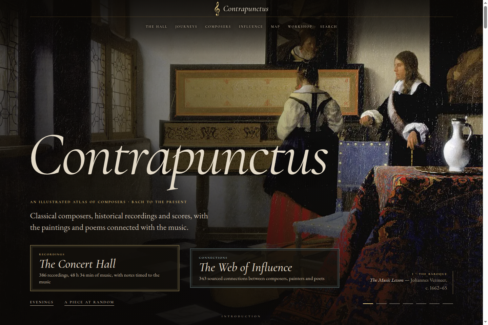

# Contrapunctus

An illustrated atlas of classical composers, from Bach to the present. Historical recordings play alongside timed listening notes and scores, with paintings, poems and maps connecting the music to the people who made it.

[Open the site](https://mottopanikeiku.github.io/contrapunctus/)

[](https://mottopanikeiku.github.io/contrapunctus/)

The atlas covers **80 composers** in seven chapters. The Concert Hall has **386 recordings**, about **48½ hours** of music, plus 63 other performances for comparison. It begins before Bach, with plainchant, Hildegard and Machaut.

## Inside the atlas

- [Concert Hall](https://mottopanikeiku.github.io/contrapunctus/hall.html): a continuous concert in birth order, or eight selected evenings. Notes appear during playback, and the player keeps going as you move between pages.
- [Composers](https://mottopanikeiku.github.io/contrapunctus/composers/index.html): biographies drawn from letters and memoirs, explanations of the music, playable notation examples and related art. There are also 206 [work pages](https://mottopanikeiku.github.io/contrapunctus/works/index.html) collecting recordings and notes for individual pieces.
- Scores: 61 recordings have engraved scores that follow the music bar by bar. The Hall also has a note-roll by voice, an orchestra view, form diagrams and a spectrogram.
- [Web of Influence](https://mottopanikeiku.github.io/contrapunctus/influence.html): 343 sourced connections among composers, teachers, performers, painters and poets. Follow a quotation or a recurring motif through different works.
- [Map](https://mottopanikeiku.github.io/contrapunctus/atlas-map.html): homes, travels and premières, year by year from 1680 to 1990, with dates and sources for each place.
- [Guided journeys](https://mottopanikeiku.github.io/contrapunctus/journeys/index.html): six sequences of recording excerpts with commentary, scores, paintings and maps, including Vienna in 1900 and Rachmaninoff in exile.
- [Compare performers](https://mottopanikeiku.github.io/contrapunctus/compare/index.html): 31 comparisons that switch between recordings at the same musical point. The [Return Lab](https://mottopanikeiku.github.io/contrapunctus/return-lab/index.html) compares a passage with its return in one recording.

[Before Bach](https://mottopanikeiku.github.io/contrapunctus/origins.html) covers the origins of notation and musical forms. The [Workshop](https://mottopanikeiku.github.io/contrapunctus/workshop.html) has eighteen lessons, from counterpoint to spectralism, with playable examples and a tuning lab. A glossary, timeline and art gallery sit alongside the chapters. Press `/` to search.

## Run locally

Use Node.js 22.12 or newer. The published site and its media assets are checked into `docs/`; an ordinary build needs no audio downloads or score engraving.

```sh
npm ci
npm run build
npm run serve
```

Open [localhost:8080](http://localhost:8080). GitHub Pages serves the same `docs/` directory from `main`, so commit the generated pages when changing the site.

Content and generated-page checks:

```sh
npm run validate
node tools/optimize/check.mjs
```

Edit the source files rather than the generated HTML:

| Path | Contents |
| --- | --- |
| `content/site.mjs` | Homepage and About copy |
| `content/composers/`, `content/eras/`, `content/pages/` | Composer chapters, periods, Before Bach and the Workshop |
| `content/listen/`, `content/dossiers/` | Recording metadata, listening notes and sources |
| `content/influence/`, `content/geo/`, `content/journeys/`, `content/compare/` | Connections, places, guided sequences and performer comparisons |
| `src/build.mjs`, `src/*.mjs` | Static page generation |
| `src/assets/` | Browser code, styles and vendored libraries |
| `tools/optimize/` | Responsive images, font subsets, minification and the service worker |

[AUTHORING.md](AUTHORING.md) covers writing and notation; [LISTENING.md](LISTENING.md) covers recordings and timed notes; [CONTENT.md](CONTENT.md) describes the data formats. The score-alignment tools have their own [instructions](tools/align/README.md).

## Sources and credits

Each chapter links its sources. [Sources & method](https://mottopanikeiku.github.io/contrapunctus/sources.html) lists recording details, score editions, timing methods and downloadable recording data.

- Recordings come from Wikimedia Commons and the Internet Archive, under the public-domain or Creative Commons terms given for each recording. One CC BY-SA recording, extracted from a Commons video, is hosted by the site. For music the Hall cannot stream, composer pages link to artists’ and labels’ own channels.
- Paintings, portraits and other reproductions come from Wikimedia Commons. [Image credits](https://mottopanikeiku.github.io/contrapunctus/credits.html) gives the source and licence of each image.
- Aligned scores use encodings from Mutopia, OpenScore and the Fryderyk Chopin Institute’s Chopin First Editions Online. Each retains its own public-domain, CC0, CC BY or CC BY-SA terms and attribution. Automatic alignment still needs checking by ear.
- [abcjs](https://abcjs.net) renders and plays the short notation examples under the MIT licence. The self-hosted fonts use the SIL Open Font Licence; licence files are in `docs/assets/fonts/`. Map outlines come from public-domain [Natural Earth](https://www.naturalearthdata.com/about/terms-of-use/) data.

The repository has no project-wide licence. The media and third-party licences above apply to their respective files.
